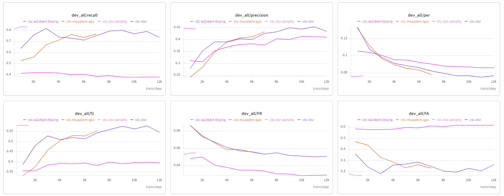

# Arabic Mispronunciation Detection with Self-Supervised Speech Models

Detecting and diagnosing pronunciation errors in Arabic read speech (Modern Standard Arabic and Quranic verses) for the **[IqraEval](https://huggingface.co/IqraEval)** shared task. A speech model transcribes what the reader actually said at the phoneme level, and comparing that with the canonical phonemes of the text reveals every substituted, deleted or inserted sound.

> **Status: active research project.** The v1 model is released with a live demo. The best model so far, a w2v-BERT 2.0 CTC recogniser trained only on 2025 data, reaches **F1 0.459** on the 2025 test set (official baseline 0.441). The goal is the **IqraEval.2 challenge (Interspeech 2026)**. See the [roadmap](#roadmap).

| | |
|---|---|
| 🤗 **Released model (v1)** | [`Haitam03/Wav2Vec2-mispronunciation-detector`](https://huggingface.co/Haitam03/Wav2Vec2-mispronunciation-detector) |
| 🎙️ **Live demo** | [`Haitam03/arabic-pronunciation-checker`](https://huggingface.co/spaces/Haitam03/arabic-pronunciation-checker) (Gradio) |
| 🏁 **Benchmarks** | [Iqra'Eval 2025 (ArabicNLP)](https://huggingface.co/spaces/IqraEval/SharedTask_ArabicNLP2025) · [IqraEval.2 (Interspeech 2026)](https://huggingface.co/spaces/IqraEval/IqraEval_Interspeech_26). Same test set: `QuranMB.v2`, 1,642 utterances |

```
Reference : < y a t a H a d d a v u n n aa s u ...
Predicted : < y a t a H a d d a s u n n aa s u ...
                              ^ v → s   substitution detected and diagnosed
```

## Highlights

- **A released model and a public demo**, on Hugging Face Hub and Spaces.
- **Rigorous, reproducible evaluation** with the challenge's official scoring scripts (hierarchical detection/diagnosis F1). The test set is used only for final checks, never for tuning.
- **Diagnostic experiments, not just training.** Probes that test whether a model really listens or reconstructs the expected text, an analysis of why validation and test scores diverged, and decoding-time error checks. [Findings below](#what-the-experiments-taught-us).
- **Training on free compute.** 2-GPU data-parallel training on Kaggle (2× T4) with 🤗 Accelerate and mixed precision. Checkpoints go to a private Hugging Face repo, and interrupted sessions resume automatically. Experiments are tracked in Weights & Biases.
- **An efficient data pipeline.** About 18 GB of parquet audio is read directly, without a dataset cache. Shuffling covers all ~1,300 row groups every epoch, with on-the-fly resampling and speed and noise augmentation.

## Results so far

Test set `QuranMB.v2` (98 verses × 18 speakers, human-annotated). Official MDD scoring. F1 is the challenge's ranking metric.

| System | F1 ↑ | Precision | Recall | Notes |
|---|---|---|---|---|
| *2025 leaderboard: 1st place (Baic)* | *0.473* | *0.371* | *0.650* | ArabicNLP 2025 |
| *2025 official HuBERT baseline* | *0.441* | *0.309* | *0.771* | |
| **v1: reference-conditioned wav2vec2 (released)** | **0.419** | 0.300 | 0.693 | would have placed 6th of 12 teams; not submitted |
| v1 + reference-checked decoding | 0.404 | 0.344 | 0.487 | fewer false alarms, but more missed errors |
| v2: reference-anchored decoder (step 8k) | 0.268 | 0.413 | 0.199 | mostly copies the reference on real speech |
| v3: CTC recogniser, xlsr-53 Arabic | 0.43 | 0.29 | 0.80 | 0.429–0.432 across checkpoints 9k–11k; highest recall |
| **v3: CTC recogniser, w2v-BERT 2.0, correct TTS clips only** | **0.459** | **0.335** | 0.729 | best result with 2025 data only; would have placed 3rd of 12 teams |
| muaalem zero-shot (Quran-pretrained, no IqraEval training) | 0.355 | 0.231 | 0.768 | output converted to IqraEval phonemes |
| muaalem fine-tuned with its own heads (`--target qps`) | 0.455 | 0.324 | 0.764 | separate category: encoder published after the 2025 challenge |
| *2026 leaderboard: 1st place* | *0.720* | *0.742* | *0.700* | uses 2026 data incl. real learner errors |

Checkpoints are chosen by dev phoneme error rate, never by test score. Within a run, test F1 varied by only ±0.005 between checkpoints, which is about the noise level of this test set.

## What the experiments taught us

1. **Feeding the reference into the model makes it predict the reference.** In v1, a probe that swapped in another sentence's reference doubled the error rate. But v1 never reproduced that wrong text, and its phoneme error rate (0.21) was three times worse than simply copying the correct reference (0.07). The reference added noise rather than useful information.
2. **The training distribution matters more than the architecture.** v1 trained only on TTS speech with injected errors, where 1 phoneme in 5 is wrong. The real test has about 1 in 15. The model learned to over-flag, which produced 5,781 false rejections.
3. **Synthetic errors can teach a text shortcut.** v2 created training errors by editing the *reference text*. It learned to spot unusual-looking references instead of listening: validation F1 was 0.57, but the real test F1 was only 0.27. Lesson: train and validate only on unmodified released data.
4. **Decoding cannot fix the acoustic model.** Accepting a detected error only when the CTC likelihood clearly favours it cut false alarms by 40%. But v1 is about as unsure of its true detections as of its false alarms, so F1 still dropped. A bias on the CTC blank, meant to suppress spurious phonemes, made false alarms *worse*: the model began dropping real phonemes, and each drop counts as a deletion error.

These results shaped v3: a plain recogniser that only hears the audio, trained on the data exactly as released. Training v3 then showed two more things:

5. **The synthetic error data is noisy, and dropping it helps.** Using a trained model as a judge on 3,000 TTS training clips, about **19% of injected substitutions** are heard as the *reference* phoneme: the TTS voice most likely never produced the labelled error. Such labels teach a model to report errors that are not audible. Training w2v-BERT on native speech plus only the *correctly read* TTS clips gave the best precision of all runs, and real errors were still caught (test recall 0.73–0.77), without a single injected-error example.
6. **Dev PER and test F1 diverge late in training.** A model trained only on correct speech keeps transcribing better (dev PER falls throughout), but slowly drifts toward the canonical pronunciation: precision rises while recall falls, and F1 stays flat after ~6k steps. Dev curves of the four runs:



*Dev set (Iqra_train dev + held-out Iqra_TTS). The w2v-BERT run (magenta) never sees injected errors, so its dev recall is low by construction. On the real test set its recall is 0.73–0.77, while its precision and false-rejection rate are the best of all runs.*

## Current approach (v3)

```
audio 16 kHz ──► self-supervised encoder ──► linear ──► CTC over 68 phonemes ──► greedy transcript
                 (wav2vec2 / w2v-BERT 2.0)                                              │
reference phonemes ───────────────────────────────────────────────────► official MDD alignment
                                                                         → error detection and diagnosis
```

- **Encoders:**
  - [`elgeish/wav2vec2-large-xlsr-53-arabic`](https://huggingface.co/elgeish/wav2vec2-large-xlsr-53-arabic) (315M);
  - [`facebook/w2v-bert-2.0`](https://huggingface.co/facebook/w2v-bert-2.0) (606M);
  - [`obadx/muaalem-model-v3_2`](https://huggingface.co/obadx/muaalem-model-v3_2): w2v-BERT 2.0 fine-tuned on 850+ h of Quran recitation ([arXiv:2509.00094](https://huggingface.co/papers/2509.00094)). Its encoder loads into the standard architecture with a new 68-phoneme output layer.
- **Data:** the released 2025 data, unmodified:
  - `Iqra_train`: 79 h of native read speech. The target is the canonical phonemes.
  - `Iqra_TTS`: synthetic Quranic recitation, correct and with injected errors. The target is the realised phonemes. `--tts-labels original` keeps only the correctly read clips (best setting, see finding 5).
- **Dev set:** `Iqra_train` dev plus held-out `Iqra_TTS` row groups. The best checkpoint is chosen by dev phoneme error rate.
- **muaalem with its own heads (`--target qps`):** instead of a new output layer, keep muaalem's pretrained phoneme and tafkheem heads. IqraEval labels are converted into its Quran Phonetic Script for training: consonants map one-to-one, gemination becomes a doubled letter, emphatic vowels become tafkheem labels, and a pause mark separates distinct identical consonants. Native labels survive the round trip exactly in 99.3% of utterances. The output is converted back to IqraEval phonemes.
- **Reference penalty (optional):** an unlikelihood term `−log(1 − p(reference phoneme))` on the frames force-aligned to each substituted phoneme. It directly penalises "hearing" the expected phoneme when a different one was spoken. As a fine-tune of the xlsr model it lowered missed errors but raised false alarms, the opposite of what this test set needs.

## Roadmap

- [x] **v1:** released model and demo, evaluated on the 2025 test set (F1 0.419)
- [x] Analysis of reference reliance, validation vs. test, and decoding-time checks ([findings](#what-the-experiments-taught-us))
- [x] Scalable training: parquet pipeline, 2-GPU training, Hub checkpointing, wandb
- [x] **v3:** CTC recogniser on all 2025 data, comparing encoders: xlsr-53 Arabic (0.43), w2v-BERT 2.0 (**0.459**), Quran-pretrained muaalem (0.455)
- [x] TTS label-noise analysis; training without injected-error clips
- [x] Reference penalty fine-tuning (did not help on this test set)
- [ ] Model ensembling (averaging phoneme probabilities of w2v-BERT and xlsr)
- [ ] Re-adding only the injected errors that are verifiably audible, to counter the recall drift
- [ ] **IqraEval.2 (Interspeech 2026):** add the 2026 real-mispronunciation data (`Iqra_Extra_IS26`) and compare with the 2026 leaderboard

Comparisons stay fair: results with 2025 data only are reported against the 2025 board. Results using 2026 data or encoders published after the 2025 challenge (e.g. muaalem, August 2025) are reported separately.

## Quick start

```bash
git clone https://github.com/hBouanane/wav2vec2-mispronunciation-detector.git
cd wav2vec2-mispronunciation-detector
pip install -r requirements.txt
git clone https://github.com/Iqra-Eval/interspeech_IqraEval ../interspeech_IqraEval   # official scoring
```

**Train on Kaggle (free, 2× T4):**
1. Run [`kaggle_data.ipynb`](kaggle_data.ipynb) once. It downloads the released parquet files (~18 GB) as notebook output.
2. Attach that output to [`kaggle_train.ipynb`](kaggle_train.ipynb), add the secrets `HF_TOKEN` (write access) and optionally `WANDB_API_KEY`, and run it. Checkpoints go to a private repo `<your HF user>/iqraeval-<RUN_NAME>`, and a new session resumes from there automatically.

Every field in [`config.py`](config.py) is also a command-line flag. The best configuration so far:
`--encoder facebook/w2v-bert-2.0 --tts-labels original --freeze-layers 6 --batch-size 4 --grad-accum 4 --warmup 500 --max-steps 12000`

**Local sanity check** (tiny random encoder, a few cached files):
```bash
python train.py --smoke --out runs/smoke --mdd-eval ../interspeech_IqraEval/mdd_eval
```

**Score on the test set** (the ground truth is gated: accept its terms on Hugging Face, then `huggingface-cli login`):
```bash
python predict_testset.py --run runs/myrun --out results/myrun
python score_testset.py --pred results/myrun/predictions.csv --mdd-eval ../interspeech_IqraEval/mdd_eval
```

## Repository

```
├── config.py            training defaults (all exposed as CLI flags)
├── data.py              parquet reader, row-group shuffling, resampling, augmentation
├── model.py             CTC model builder (wav2vec2 / w2v-BERT / muaalem), decoding, reference penalty
├── train.py             multi-GPU training: dev evaluation, Hub checkpoints, wandb
├── utils.py             phoneme vocabulary, CTC forced alignment, edit alignment
├── predict_testset.py   transcribe the QuranMB.v2 test set
├── score_testset.py     official MDD metrics + PER
├── mdd_metric.py        wrapper around the official scoring scripts
├── muaalem.py           muaalem inference + Quran Phonetic Script <-> IqraEval phoneme conversion
├── muaalem_zero_shot.py zero-shot evaluation of muaalem
├── dump_logits.py       save a model's frame log-probabilities (for analyses)
├── blank_bias.py        decoding-time blank-bias sweep
├── tts_noise.py         TTS label-noise analysis (model as judge)
├── kaggle_data.ipynb    one-time data download on Kaggle
├── kaggle_train.ipynb   training notebook (Hub repo derived from your HF token)
└── docs/                figures for this README
```

Models and run outputs (checkpoints, predictions, metrics) are not stored in git; they live on the Hugging Face Hub.

Earlier versions are kept in git:
- `v1` (tag): the released reference-conditioned model and its training code.
- `v2` (branch): the reference-anchored decoder experiment.

## Acknowledgements

- The [IqraEval](https://huggingface.co/IqraEval) organisers, for the datasets, the phoneme inventory and the evaluation scripts.
- [elgeish/wav2vec2-large-xlsr-53-arabic](https://huggingface.co/elgeish/wav2vec2-large-xlsr-53-arabic), [facebook/w2v-bert-2.0](https://huggingface.co/facebook/w2v-bert-2.0) and [obadx/muaalem-model-v3_2](https://huggingface.co/obadx/muaalem-model-v3_2) (Abdelfattah et al., 2025) for the pretrained encoders.

## Citation

```bibtex
@software{bouanane2025arabicmdd,
  title  = {Arabic Mispronunciation Detection with Self-Supervised Speech Models},
  author = {Bouanane, Haitam},
  year   = {2025},
  url    = {https://github.com/hBouanane/wav2vec2-mispronunciation-detector}
}
```

## License

[MIT](LICENSE)
